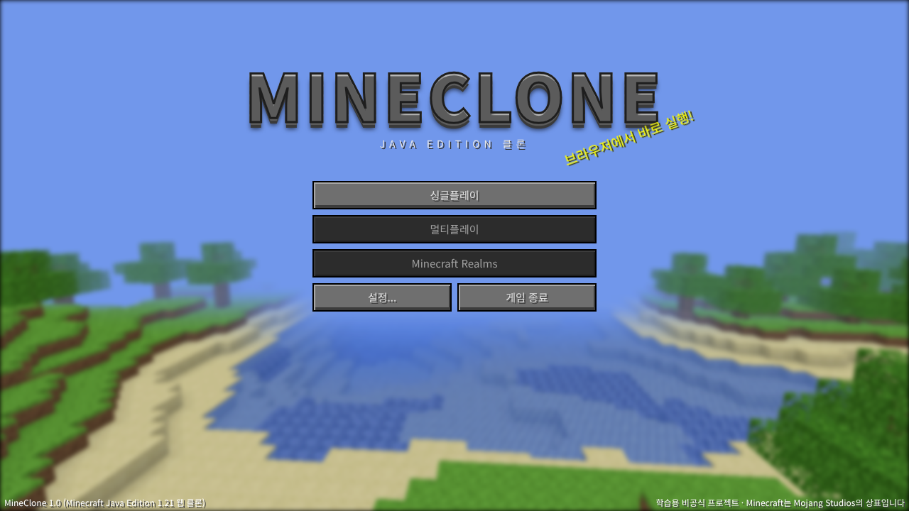
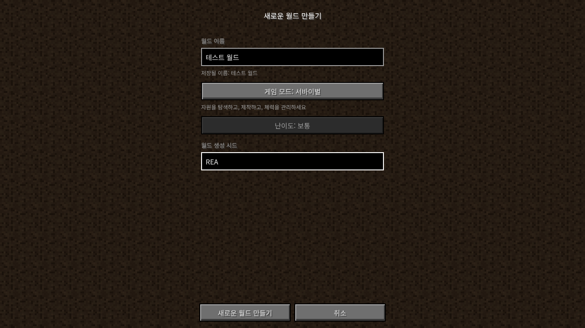
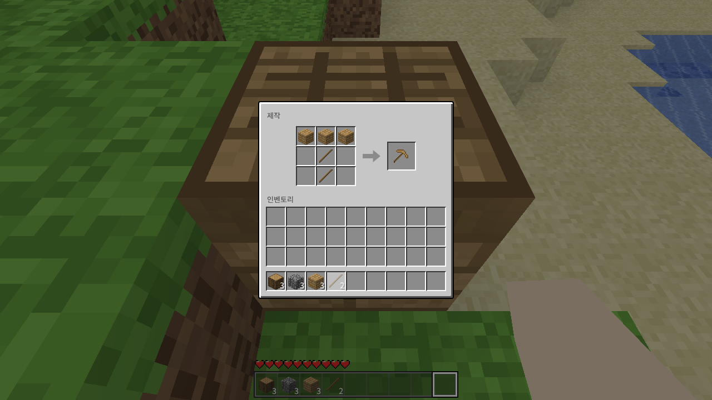
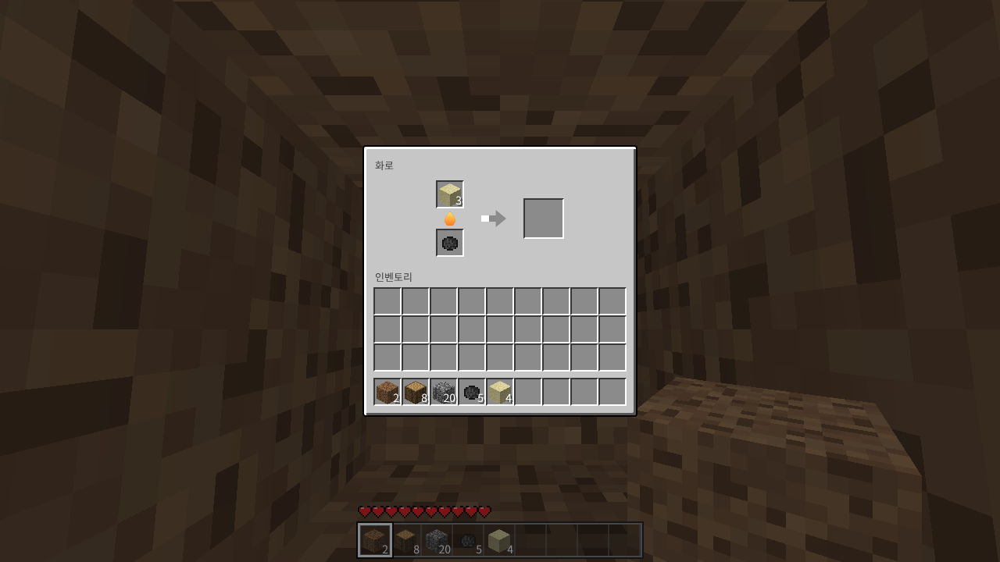
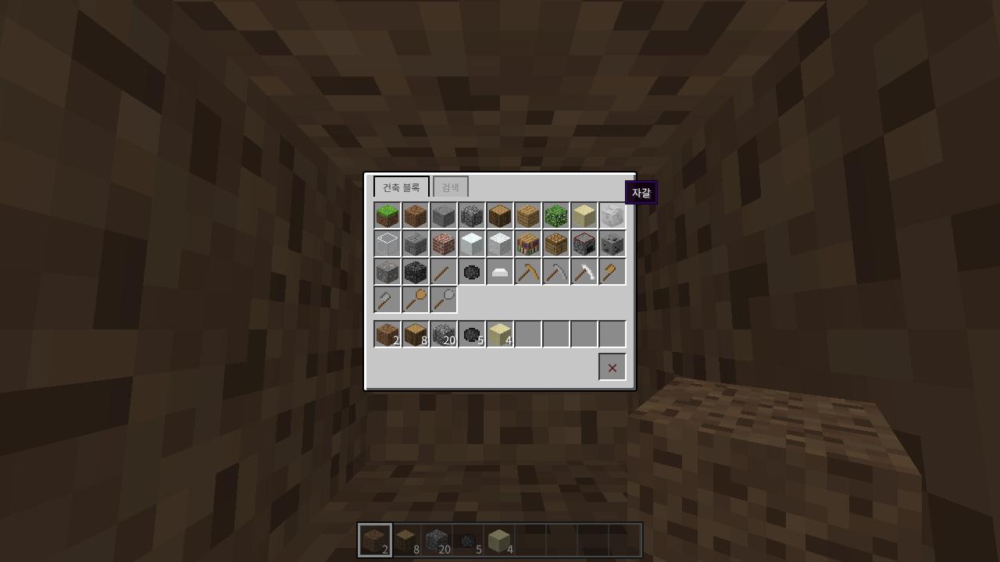
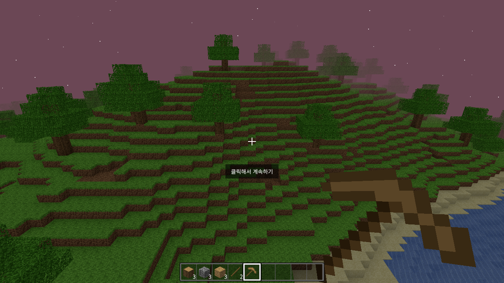

# MineClone — Minecraft Java Edition 웹 클론

AI 기반 역공학(REA)으로 **Minecraft: Java Edition 1.21**의 화면과 동작을 관찰·분석해서 브라우저용으로 다시 구현한 학습용 프로젝트입니다.
원본 소스코드와 리소스(텍스처, 사운드, 로고)는 쓰지 않았습니다. 모든 텍스처와 효과음은 코드로 직접 생성합니다.



## 실행 방법

ES 모듈을 사용하므로 `index.html`을 더블클릭하면 실행되지 않습니다. 로컬 서버로 열어야 합니다.

```bash
npx serve .            # 또는 VS Code의 Live Server 확장
# 브라우저에서 http://localhost:3000 접속
```

GitHub Pages(Settings → Pages → main 브랜치)에 올리면 설치 없이 URL로 바로 플레이할 수 있습니다.

## 데모 영상

- `mineclone_demo.mp4`: MineClone 플레이 13개 장면, 한국어 자막과 AI 음성(TTS) 나레이션 (약 2분 32초)
- 원본과 좌우 비교 영상 만들기: [docs/촬영_순서표.md](docs/촬영_순서표.md) 순서대로 원본을 녹화한 뒤 `docs/make_side_by_side.sh 원본.mp4 mineclone_demo.mp4 결과.mp4`

## 조작법

| 키 | 동작 |
|---|---|
| W A S D | 이동 |
| 마우스 | 시점 회전 (게임 화면을 클릭하면 마우스가 고정됨) |
| 스페이스 | 점프 / 수영 / 비행 중 상승 |
| Shift | 웅크리기(모서리에서 안 떨어짐) / 비행 중 하강 |
| W 두 번 빠르게 또는 Ctrl | 달리기 (Ctrl+W는 브라우저 탭을 닫으므로 W 두 번을 권장) |
| 좌클릭 꾹 | 블록 부수기 |
| 우클릭 | 블록 설치 / 제작대·화로 열기 |
| 휠 클릭 | 블록 집기 |
| 1~9, 마우스 휠 | 핫바 선택 |
| E | 인벤토리 (크리에이티브는 아이템 목록) |
| 스페이스 두 번 | 비행 켜기/끄기 (크리에이티브) |
| F3 | 디버그 화면 |
| F1 | HUD 숨기기 |
| Esc | 게임 메뉴 |

## 작업 환경

| 항목 | 내용 |
|---|---|
| OS | Windows 11 (개발), Linux 헤드리스 Chrome (자동 테스트) |
| 언어/라이브러리 | JavaScript (ES Modules), Three.js 0.160 (WebGL) |
| 저장 | IndexedDB (월드), localStorage (설정) |
| 사용 AI 모델 | Claude (Anthropic) |
| 빌드 도구 | 없음 (정적 파일만으로 실행) |

## 원본과 기능 비교

| 구분 | 기능 | 원본 (MC 1.21) | MineClone | 비고 |
|---|---|---|---|---|
| 화면 | 타이틀 화면 (파노라마 배경, 스플래시 문구) | O | **성공** | 배경은 실제 생성된 월드를 회전시켜 렌더링 |
| 화면 | 월드 선택 (목록, 플레이, 삭제) | O | **성공** | "다시 만들기"는 비활성 |
| 화면 | 새 월드 만들기 (이름, 게임 모드, 시드) | O | **성공** | 같은 시드 = 같은 지형 |
| 화면 | 설정 (시야, 렌더 거리, 감도, 음량, 화면 흔들림, 구름) | O | **성공** | 스킨/언어 설정은 비활성 |
| 화면 | 게임 메뉴(일시정지) | O | **성공** | 발전 과제, 통계, LAN 공개는 비활성 |
| 화면 | 인벤토리 / 제작대 / 화로 / 크리에이티브 인벤토리 | O | **성공** | |
| 화면 | 사망 화면 / 리스폰 | O | **성공** | |
| 화면 | F3 디버그 화면 | O | **성공** | 좌표, 청크, 방향, 시간, 바라보는 블록 |
| 월드 | 시드 기반 무한 지형 (평지, 언덕, 산, 바다, 해변) | O | **성공** | Simplex 노이즈 직접 구현 |
| 월드 | 동굴, 광석(석탄·철), 나무, 기반암 | O | **성공** | |
| 월드 | 바이옴 (사막, 정글, 설원 등) | O | 부분 | 높은 산 꼭대기의 눈만 구현 |
| 월드 | 청크 단위 로딩/언로딩 | O | **성공** | 16×16 청크, 높이 96 (원본은 384) |
| 월드 | 낮/밤 주기, 해·달·별, 구름 | O | **성공** | 20분 = 하루 (원본과 동일) |
| 월드 | 빛 전파 (횃불, 블록 광원) | O | 실패 | 하늘빛 근사 + AO만 구현 |
| 월드 | 물 흐름 | O | 부분 | 옆에 물이 있으면 빈칸을 채우는 정도 |
| 플레이어 | 이동, 점프, 달리기, 웅크리기, 충돌 | O | **성공** | 원본 속도값(4.317 m/s 등) 사용 |
| 플레이어 | 수영, 비행(크리에이티브) | O | **성공** | |
| 플레이어 | 체력, 낙하 데미지, 익사, 자연 회복 | O | **성공** | 3칸 초과 낙하 시 데미지 (원본 공식) |
| 플레이어 | 배고픔 | O | 실패 | 음식/섭취 시스템 미구현 |
| 블록 | 꾹 눌러 부수기 + 균열 단계 표시 | O | **성공** | 원본 경도·도구 배율 공식 사용 |
| 블록 | 블록 설치, 방향 있는 블록(화로) | O | **성공** | |
| 블록 | 레드스톤 | O | 실패 | 틱 단위 동작을 관찰만으로 재현하기 어려움 |
| 아이템 | 인벤토리 클릭 규칙 (좌/우클릭, Shift 이동) | O | **성공** | |
| 아이템 | 2×2, 3×3 제작 (좌우 반전 레시피 포함) | O | **성공** | 레시피 11개 |
| 아이템 | 화로 제련 (연료, 진행 화살표, 불꽃) | O | **성공** | 모래→유리, 조약돌→돌, 철광석→철 주괴 |
| 아이템 | 도구 내구도 | O | 실패 | |
| 아이템 | 바닥에 떨어진 아이템(엔티티) | O | 실패 | 부순 블록은 인벤토리로 바로 들어감 |
| 엔티티 | 몹 (좀비, 소 등), 전투 | O | 실패 | |
| 멀티 | 멀티플레이, Realms | O | 실패 | 비공개 네트워크 프로토콜 |
| 기타 | 저장/불러오기 (블록 변경, 인벤토리, 위치, 화로) | O | **성공** | 변경된 블록만 저장 (diff 방식) |
| 기타 | 효과음 | O | 부분 | Web Audio로 합성한 소리 (원본 음원 미사용) |
| 기타 | 1인칭 손 / 들고 있는 아이템 | O | **성공** | 3인칭 시점(F5)은 미구현 |

## 실패·부분 구현 원인 분석

- **빛 전파**: 원본은 블록마다 하늘빛과 블록빛 0~15를 저장하고 BFS로 퍼뜨립니다. 브라우저에서 청크마다 이 계산을 하면 메싱 시간이 크게 늘어나서, 기둥 최상단 블록 높이로 하늘빛을 근사했습니다.
- **레드스톤·물 흐름**: 게임 틱 순서와 블록 업데이트 순서에 의존하는데, 이 순서는 화면 관찰만으로는 알 수 없습니다. 역분석의 대표적인 한계입니다.
- **몹 AI, 아이템 엔티티**: 엔티티 시스템, 경로 탐색, 물리 충돌을 새로 설계해야 해서 과제 기간 안에 범위를 넘었습니다.
- **멀티플레이**: 서버 프로토콜이 공개되지 않아 관찰로 재현할 수 없고, 별도 서버도 필요합니다.
- **월드 높이**: 원본은 높이 384지만 브라우저 메모리와 메싱 속도 때문에 96으로 줄였습니다.

## 폴더 구조

```
index.html          화면 구조 (타이틀, 월드 선택, 설정, HUD 등)
css/style.css       원본 UI를 관찰해 재현한 스타일
js/main.js          렌더링, 화면 전환, 입력, 게임 루프
js/world.js         지형 생성, 청크, 메싱(면 컬링 + AO), 레이캐스트
js/player.js        플레이어 물리 (충돌, 중력, 수영, 낙하 데미지)
js/inventory.js     인벤토리, 제작, 화로, 핫바
js/blocks.js        블록/아이템/레시피/경도 정의
js/textures.js      16×16 텍스처와 아이콘을 코드로 생성
js/noise.js         시드 난수와 Simplex 노이즈
js/sound.js         Web Audio 효과음
js/storage.js       IndexedDB 저장
tests/              지형 생성·메싱·레시피 테스트 (npm test)
```

## 스크린샷

| 월드 만들기 | 제작대 |
|---|---|
|  |  |
| **화로** | **크리에이티브 인벤토리** |
|  |  |



---
Minecraft는 Mojang Studios의 상표입니다. 이 프로젝트는 수업 과제용 비공식 클론이며 Mojang 또는 Microsoft와 관련이 없습니다.
